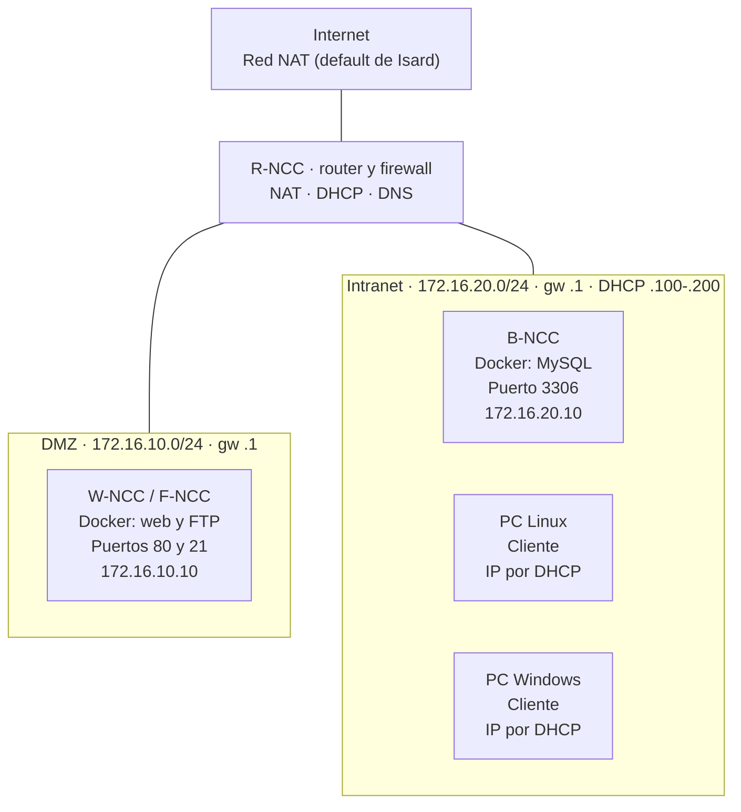

# Diagrama de arquitectura (v1)

Proyecto P0.0 Desplegament de la infraestructura (módulo 0379, ASIX).

GitHub dibuja el diagrama automáticamente al abrir este archivo.

## Notas

- Todo el tráfico entre redes pasa por el router `R-NCC`, que es el firewall.
- El servidor web de la DMZ solo puede consultar la BBDD por el puerto 3306.
- Los hostnames llevan `NCC` como marcador hasta tener el número de equipo.
- Pendiente de confirmar: si `F-NCC` va en una VM aparte (IP `172.16.10.20`).
- Las VM tienen IP fija; los contenedores Docker publican sus puertos hacia la VM.
