# Base de datos (B-05)

Proyecto P0.0-ASIXc2gC-G05 · módulo 0379 · responsable: Piero · última revisión: 2026-11-17

Documentación del servidor de la base de datos: MySQL 8.0 en un contenedor Docker, en la VM de la Intranet (`192.168.20.10`, puerto 3306). Incluye la preparación del CSV de centros educativos, la carga de datos y las comprobaciones.

> Nota: en el texto, `B-N05` y `R-N05` son `B-05` y `R-05`. Algunas capturas muestran el direccionamiento `172.16.x.x`, usado antes de pasar a `192.168.x.x`. La captura del fichero `.env` no se incluye porque contiene contraseñas, y ese fichero se queda solo en el servidor.

Para el despliegue del servidor de la base de datos he creado en el
nuvulet dos máquinas un servidor ubuntu y un ubuntu desktop para hacer
el despliegue del servidor de una manera más sencilla, para ello les he
añadido una tarjeta de red personal. Posteriormente en ambas he creado
el usuario bchecker. Luego he tenido que configurar las ip de la tarjeta
personal de ambas máquinas para que tengan conectividad entre ellas

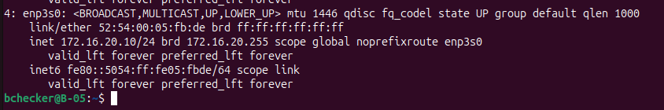

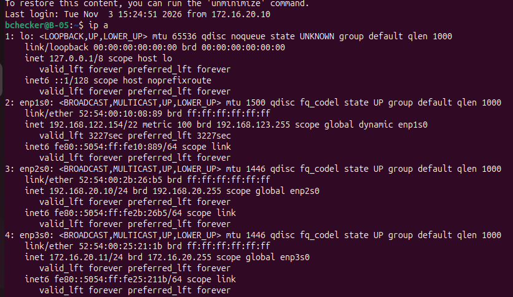

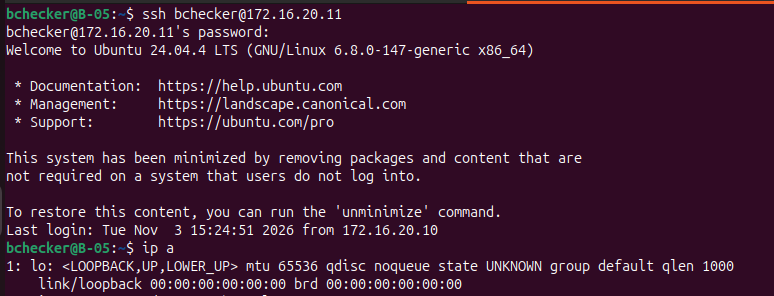

Después he configurado el fichero yml del netplan del servido B-N05, con
la configuración y hago las comprobaciones necesarias para comprobar la
salida a internet, no quité la tarjeta “default” del servidor por si en
elgun momento se me caia la conectividad a internet, por eelo puse una
metrica mayor para que tuviera prioridad la salida a internet del R-N05

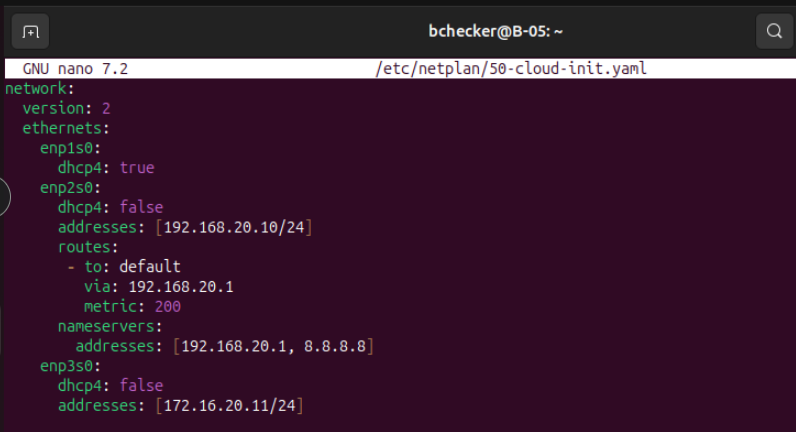

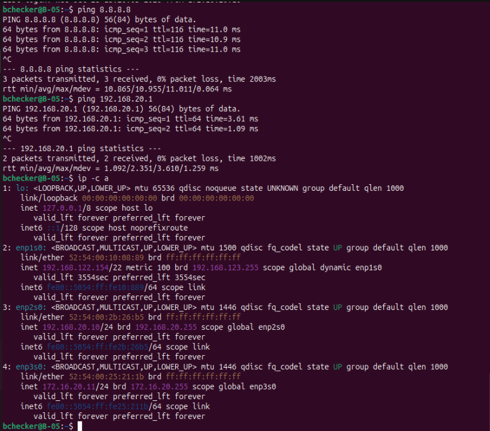

Luego en el B-N05, he instalado docker, he comprobado que el servicio
esté activo y he probado cargando la imagen del hello-world y he
configurado para usar docker sin sudo, luego he instalado docker compose
y verificado su instalación

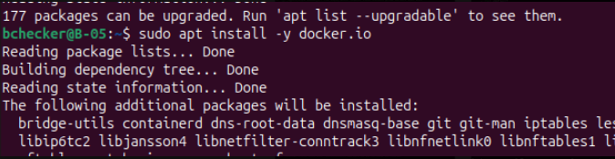

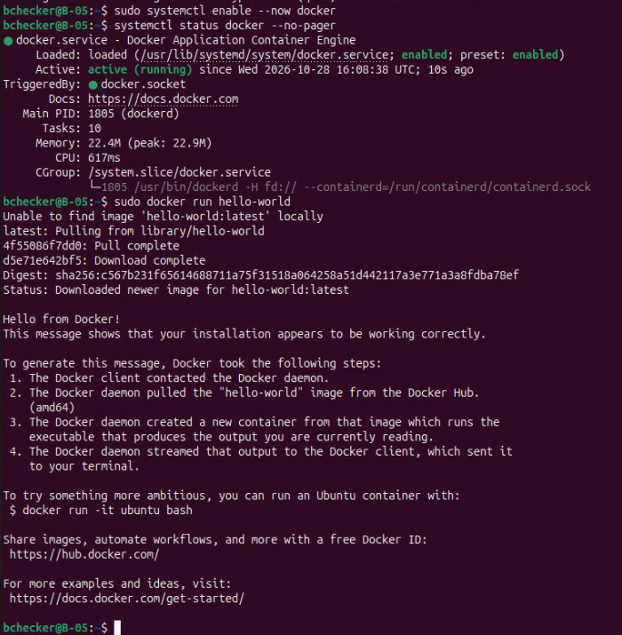

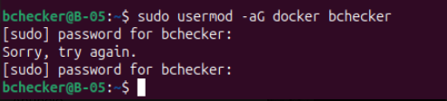

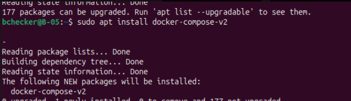

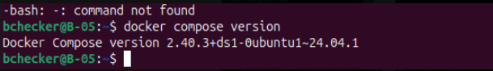

Teniendo lo anterior listo procedo ha revisar el fichero CSV de las
escuelas para con un script poder limpiar los datos innecesarios y poder
tener el csv limpio, lo haré en el cliente que estoy usando para hacer
el desplegamiento para luego pasarlo al servidor con ssh

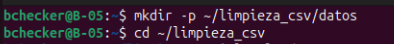

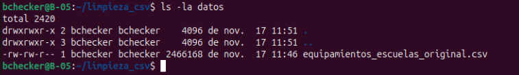

Antes de usar ningún script reviso el fichero a mano. Con file veo que
está codificado en UTF-16 y no en UTF-8, con wc -l compruebo que tiene
2710 líneas (la cabecera y 2709 filas) y con od veo que empieza por los
bytes ff fe, la marca que identifica el UTF-16. Al convertirlo con iconv
y mostrar la segunda línea con cat -A descubro que cada fila lleva
delante un carácter invisible (BOM), que si no se elimina haría que los
identificadores no coincidan al buscarlos en la base de datos.

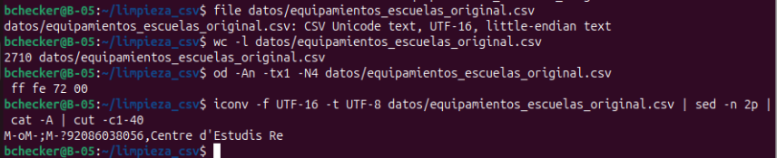

Los dos scripts que uso para analizar y limpiar el CSV los ha generado
la IA, a partir del análisis del fichero que le fui pasando, y los he
ejecutado y comprobado yo en el Desktop. Los dos están escritos en
Python y solo usan la librería estándar, así que no hace falta instalar
nada.

- **analizar_csv.py** solo lee el CSV original y no lo modifica. Detecta la codificación mirando los primeros bytes del fichero, identifica el separador y cuenta las columnas y las filas. Después muestra, para cada columna, cuántos valores vacíos tiene, cuántos valores distintos y la longitud máxima. Al final resume los hallazgos: columnas totalmente vacías, filas con el carácter invisible (BOM), número de centros distintos frente al de filas, los valores de los campos verdadero/falso y el formato de las fechas. Con eso decido qué hay que limpiar.

- **preparar_csv.py** genera el CSV limpio a partir del original. Lo lee como UTF-16 y lo guarda en UTF-8, elimina el BOM de cada valor y descarta las 6 columnas vacías. También convierte las fechas al formato que entiende MySQL, pasa los True/False a 1/0 y escribe \N en los campos vacíos para que se carguen como NULL. Se ejecuta indicando el fichero de entrada y el de salida, y al terminar muestra cuántas filas y columnas ha escrito.

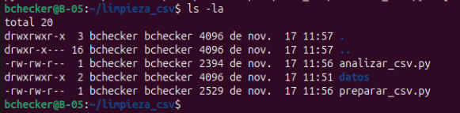

Ejecuto analizar_csv.py, que solo lee el fichero y no lo modifica.
Confirma que el separador es la coma, que hay 40 columnas y 2709 filas,
y detecta cuatro cosas que condicionan la limpieza: 6 columnas
totalmente vacías, el BOM en las 2709 filas, que los booleanos vienen
como True/False y las fechas en formato ISO con zona horaria, y que solo
hay 1981 centros distintos porque cada centro se repite por cada
teléfono y etiqueta de enseñanza. Por esto último el identificador del
centro no puede ser la clave primaria de la tabla.

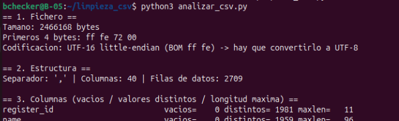

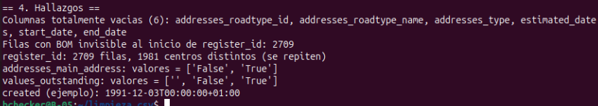

Con esos datos ejecuto preparar_csv.py, que convierte el fichero a
UTF-8, elimina el BOM y las 6 columnas vacías, pasa las fechas a formato
AAAA-MM-DD HH:MM:SS y los booleanos a 1 y 0, y marca los campos vacíos
como \N para que MySQL los cargue como NULL. Le indico un nombre de
salida distinto para no sobrescribir el CSV que ya está en el servidor.
El resultado son 2709 filas y 34 columnas.

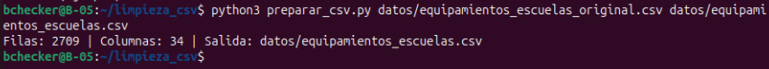

Compruebo el fichero resultante: file indica que ahora es UTF-8, wc -l
da 2710 líneas, igual que el original, y la segunda línea ya no lleva el
BOM, los acentos se ven bien, los campos vacíos aparecen como \N y la
fecha tiene el formato que espera MySQL.

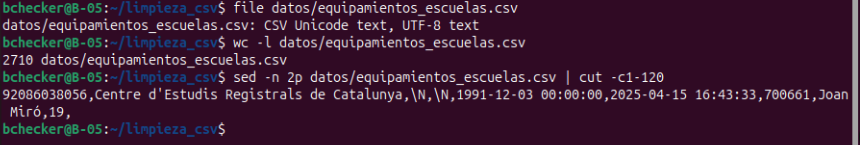

Luego después de crear el directorio y subdirectorios
P0.0-ASIXc2gC-Gnnoer, configs, bbdd, datos, en el B-N05 mediante ssh
paso el fichero csv limpio dentro del directorio datos

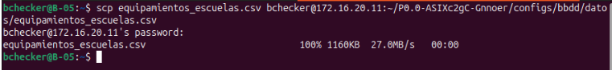

Compruebo de que esté en el directorio asignado

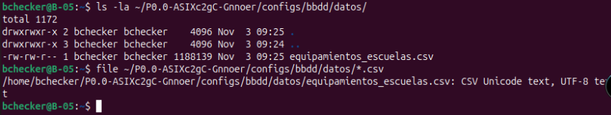

Después he cambiado de nombre al directorio por “proyectoG05”

Posteriormente dentro del directorio ~/proyectoG05/configs/bbdd primero
creo los .env uno sera una plantilla el .env.example y el que usará
docker será .env, hago esto porque el .env.example es el que subiré al
repositorio que en la primera línea no contendrá la contraseña y el ,env
se queda en el servidor

Después he pasado mediante ssh los ficheros crear_tabla.sql, que sirve
para crear la tabla de la base de datos, cargar_csv, que sirve para leer
el CSV y meterlo en la tabla y el docker-compose.yml, que describe el
contenedor de MySQL (qué imagen, qué puertos, qué datos) para crearlo
con un solo comando, docker compose up -d

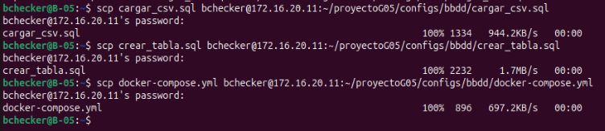

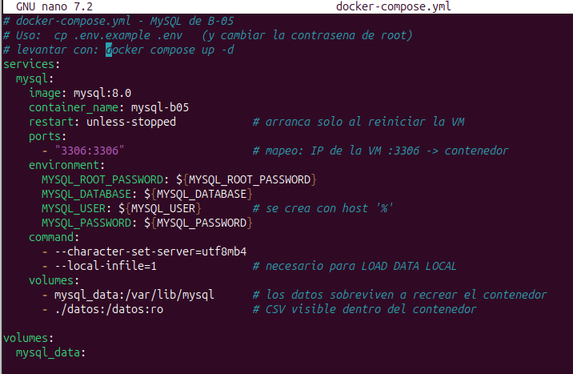

Compruebo que el directorio contenga los ficheros correspondientes y
también compruebo que que este instalado docker compose y que esté en
los grupos correspondientes para usarlo sin sudoi

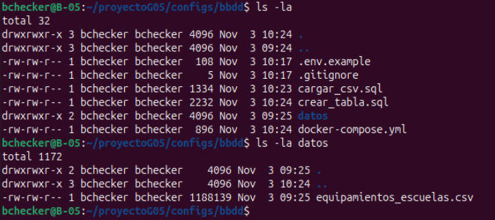

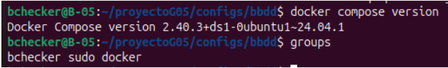

Dentro del directorio ~/proyectoG05/configs/bbdd levanto el contenedor
de MySQL con docker compose up -d. En la primera ejecución Docker
descarga la imagen mysql:8.0 y crea la red bbdd_default, el volumen
bbdd_mysql_data y el contenedor mysql-b05. Compruebo con docker compose
ps que el contenedor está en marcha con el puerto 3306 mapeado, y reviso
los logs con docker logs hasta ver el mensaje “ready for connections”,
que indica que MySQL ya acepta conexiones.

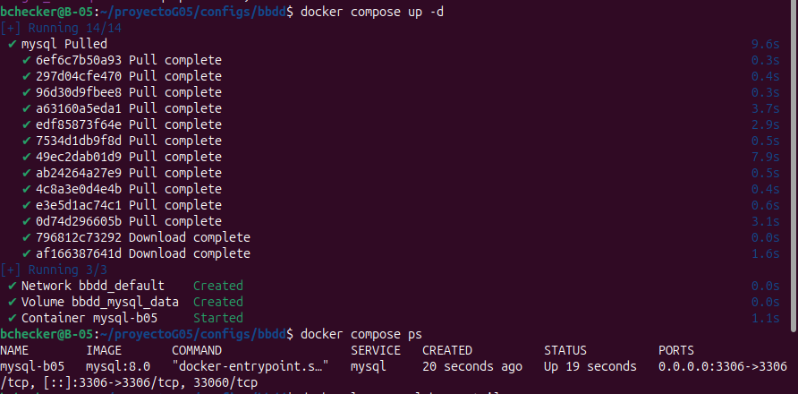

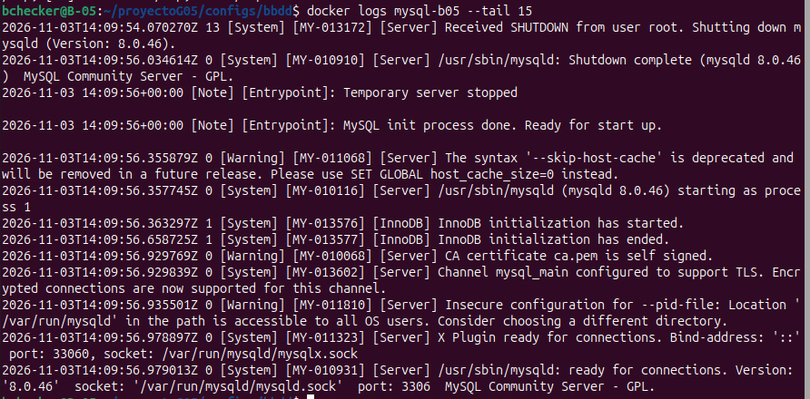

Compruebo con el usuario root que bchecker se ha creado con host %, es
decir, que podrá conectarse desde cualquier IP. Es necesario para que
más adelante lo haga el servidor web de la DMZ.

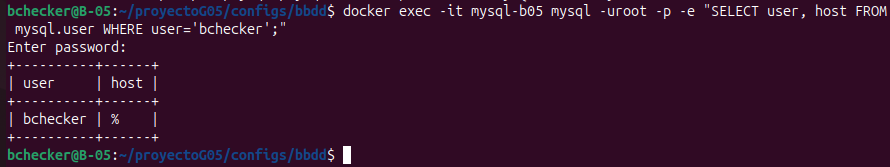

Creo la tabla ejecutando crear_tabla.sql dentro del contenedor (el aviso
de MySQL sobre la contraseña en la línea de comandos es solo
informativo). Verifico con SHOW TABLES y DESCRIBE que existe
equipamientos_educacion con las 35 columnas esperadas: un id
autoincremental como clave primaria y las 34 columnas del CSV limpio.

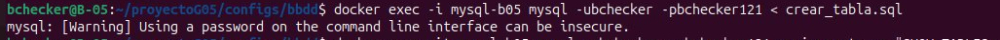

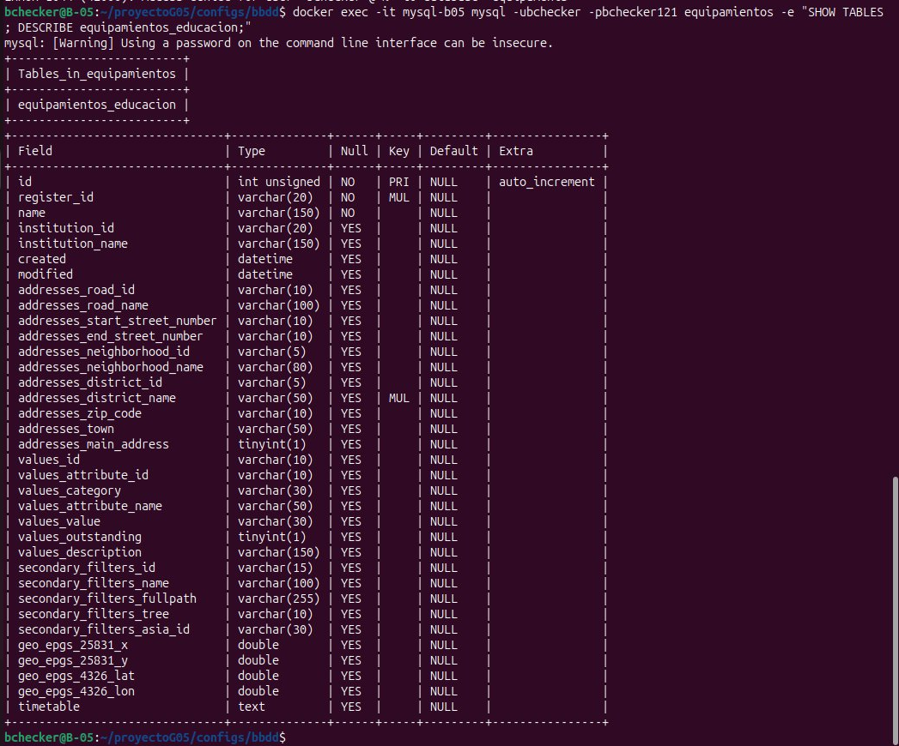

Cargo los datos con cargar_csv.sql, usando --local-infile=1 para
permitir la carga del fichero. El resultado, 2709 filas y 1981 centros
distintos, coincide con el análisis previo del CSV. Hay más filas que
centros porque cada centro aparece repetido por cada teléfono y etiqueta
de enseñanza.

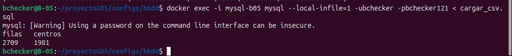

Verifico los datos desde MySQL con tres consultas: el total de filas,
una muestra de cinco registros donde se ven bien los acentos, y el
número de centros por distrito, siendo el Eixample el que más tiene.

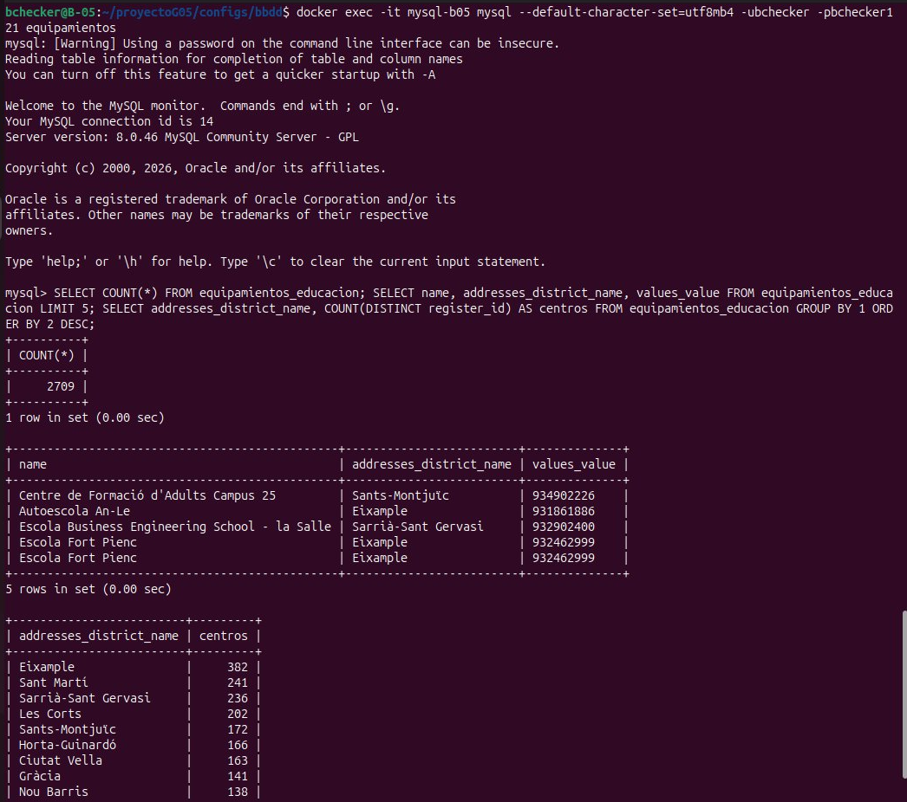

Con ss -tlnp \| grep 3306 compruebo que el puerto 3306 está a la escucha
en todas las interfaces (0.0.0.0). Esto confirma que el mapeo del
contenedor funciona y que MySQL será accesible por la IP de la Intranet,
192.168.20.10.

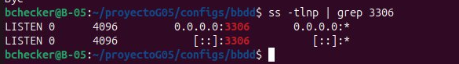

Reinicio la máquina para comprobar la persistencia y vuelvo a entrar por
SSH desde el Desktop. El contenedor se ha levantado solo gracias a
restart: unless-stopped y los datos siguen ahí gracias al volumen: 2709
filas y 1981 centros distintos. Además intento consultar la tabla
mysql.user con bchecker y MySQL me lo deniega, porque este usuario solo
tiene permisos sobre su base de datos y no sobre las tablas del sistema.

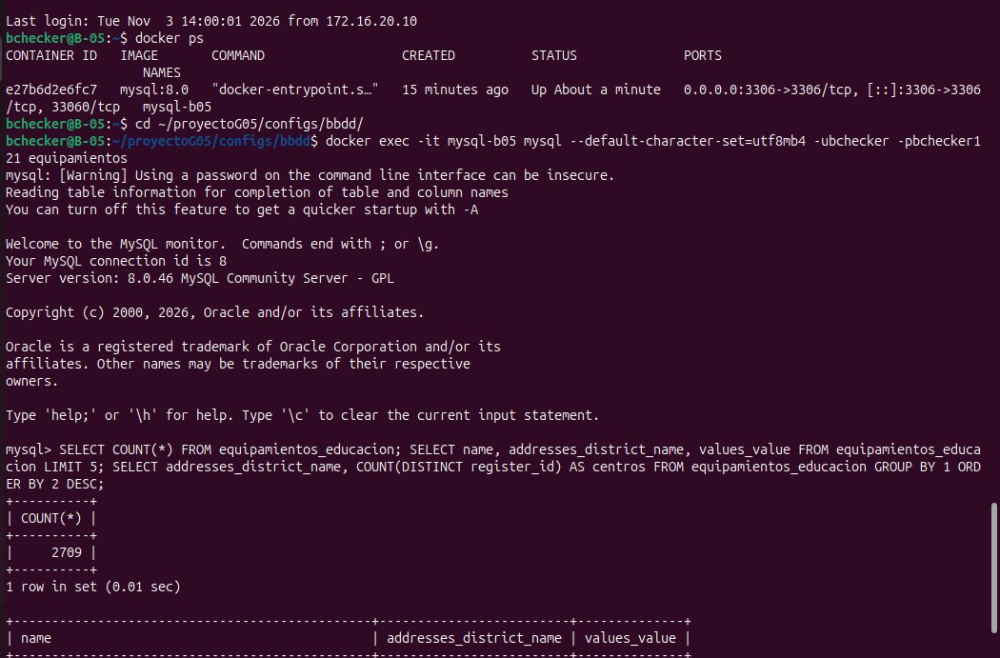

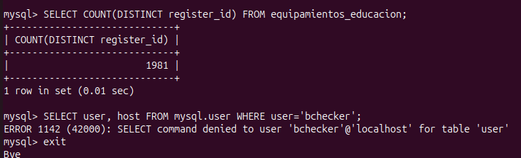

Por último compruebo con CURRENT_USER() y SHOW GRANTS que el usuario es
bchecker@% y que tiene todos los privilegios únicamente sobre la base de
datos equipamientos, que es lo que necesita la aplicación del servidor
web.

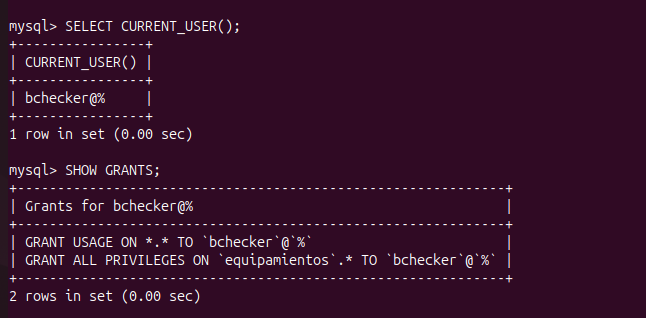
