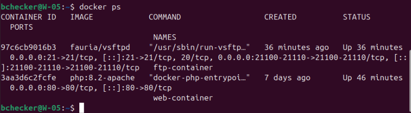
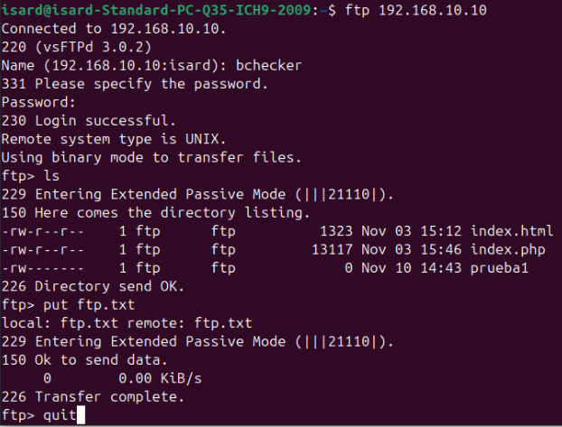
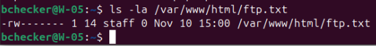

# Documentación del Servicio FTP (DMZ — W-05)

## 1. Descripción de la Arquitectura

El servicio FTP de la máquina **W-05** (`192.168.10.10`), ubicada en la Zona Desmilitarizada (DMZ) del **Proyecto G05**, ha sido desplegado en una arquitectura contenerizada mediante Docker.

Este servicio permite la administración, actualización y subida remota de archivos en tiempo real directamente sobre el directorio raíz del servidor web (`/var/www/html`), compartiendo un volumen persistente anfitrión-contenedor.

* **Imagen Docker**: `fauria/vsftpd`
* **Modo de Operación**: Pasivo (PASV)
* **Directorio Mapeado**: `/var/www/html` en la máquina anfitriona `W-05` hacia `/home/vsftpd/bchecker` en el contenedor.

---

## 2. Parámetros de Red y Firewall (UFW)

Para permitir la conexión inicial de control y la posterior transferencia de datos en modo pasivo a través de la red DMZ, se han habilitado los siguientes puertos en el firewall `ufw` del anfitrión:

| Servicio | Puerto / Rango | Protocolo | Descripción |
| :--- | :--- | :--- | :--- |
| **FTP Control** | `21` | TCP | Canal de comandos, autenticación y sesión FTP |
| **FTP Pasivo** | `21100 - 21110` | TCP | Rango de puertos dinámicos para datos y listados |

### Configuración aplicada en UFW:

```bash
sudo ufw allow 21/tcp comment 'FTP Command Port'
sudo ufw allow 21100:21110/tcp comment 'FTP Passive Ports'
sudo ufw reload
```

---

## 3. Credenciales y Parámetros de Conexión

Para la gestión remota de archivos mediante clientes CLI (como `ftp`) o clientes gráficos (como FileZilla), se han establecido los siguientes datos de acceso:

* **Servidor (Host)**: `192.168.10.10`
* **Puerto**: `21`
* **Usuario**: `bchecker`
* **Contraseña**: `bchecker121`
* **Modo de Transferencia**: Pasivo (PASV)

---

## 4. Script de Despliegue Automatizado (`deploy_ftp.sh`)

El despliegue del servicio FTP, la configuración del volumen persistente y las reglas del cortafuegos se ejecutan mediante el siguiente script en Bash:

```bash
#!/bin/bash

# ==============================================================================
# Script de Despliegue Automático — Servidor FTP Docker (W-05)
# ==============================================================================

set -e

CONTAINER_NAME="ftp-container"
WEB_DIR="/var/www/html"
FTP_USER="bchecker"
FTP_PASS="bchecker121"
PASV_MIN="21100"
PASV_MAX="21110"
SERVER_IP="192.168.10.10"

echo "=== 1. Asegurando el directorio objetivo ($WEB_DIR) ==="
sudo mkdir -p "$WEB_DIR"
sudo chown -R 1000:1000 "$WEB_DIR"

echo "=== 2. Configurando puertos en el Firewall UFW ==="
sudo ufw allow 21/tcp comment 'FTP Command Port' > /dev/null 2>&1 || true
sudo ufw allow ${PASV_MIN}:${PASV_MAX}/tcp comment 'FTP Passive Ports' > /dev/null 2>&1 || true
sudo ufw reload > /dev/null

echo "=== 3. Comprobando y limpiando contenedor anterior ==="
if docker ps -a --format '{{.Names}}' | grep -q "^${CONTAINER_NAME}$"; then
    echo "Deteniendo y eliminando contenedor FTP existente..."
    docker stop "$CONTAINER_NAME"
    docker rm "$CONTAINER_NAME"
fi

echo "=== 4. Desplegando contenedor FTP (fauria/vsftpd) ==="
docker run -d \
  --name "$CONTAINER_NAME" \
  --restart always \
  -p 21:21 \
  -p ${PASV_MIN}-${PASV_MAX}:${PASV_MIN}-${PASV_MAX} \
  -e FTP_USER="$FTP_USER" \
  -e FTP_PASS="$FTP_PASS" \
  -e PASV_ADDRESS="$SERVER_IP" \
  -e PASV_MIN_PORT="$PASV_MIN" \
  -e PASV_MAX_PORT="$PASV_MAX" \
  -v "$WEB_DIR":/home/vsftpd/"$FTP_USER" \
  fauria/vsftpd

echo ""
echo "=== Despliegue del Servidor FTP completado con éxito ==="
echo "--------------------------------------------------------"
echo "Servidor FTP IP:    $SERVER_IP"
echo "Puerto:             21 (Modo Pasivo: $PASV_MIN-$PASV_MAX)"
echo "Usuario:            $FTP_USER"
echo "Contraseña:         $FTP_PASS"
echo "Directorio mapeado: $WEB_DIR"
echo "--------------------------------------------------------"
```

---

## 5. Verificación y Pruebas de Funcionamiento

### A. Estado del Contenedor Docker
Ejecutar en la consola de **W-05** para confirmar la ejecución del servicio y la publicación de puertos:

```bash
docker ps
```
*Resultado esperado:* Contenedor `ftp-container` en estado `Up` vinculando los puertos `21/tcp` y `21100-21110/tcp`.



### B. Prueba de Conexión y Subida por Terminal (CLI)
Desde un equipo cliente de la red local con acceso a la DMZ:

```bash
ftp 192.168.10.10
# Introducir usuario: bchecker
# Introducir contraseña: bchecker121
ls
put ftp.txt
quit
```


### C. Verificación de Sincronización en el Anfitrión
Comprobar en la consola de **W-05** que el archivo subido mediante el cliente FTP se ha creado inmediatamente en el directorio del servidor web:

```bash
ls -la /var/www/html/ftp.txt
```

